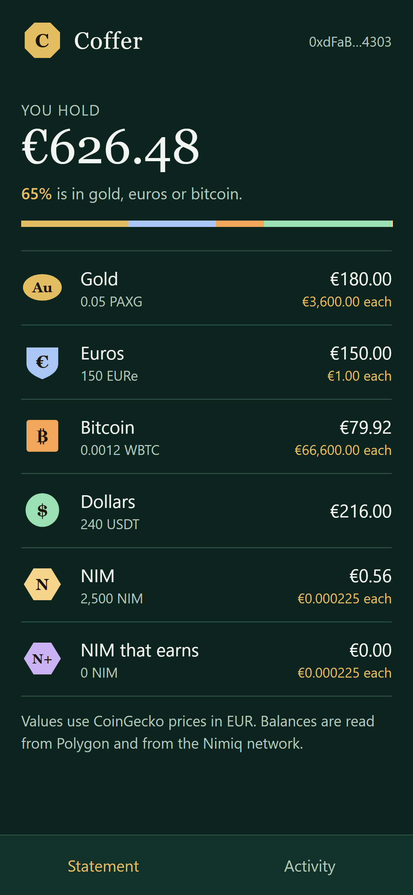
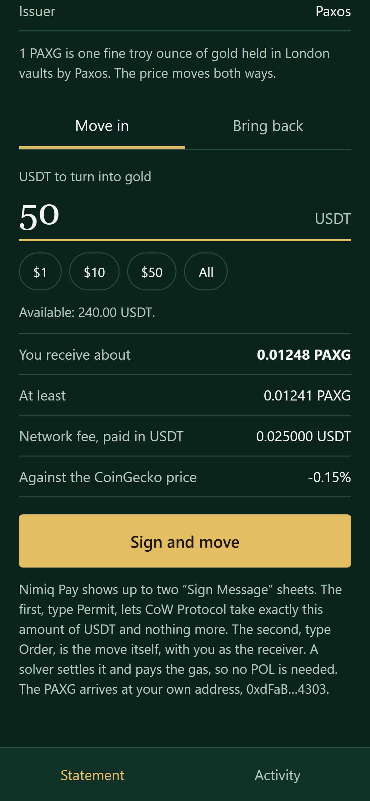
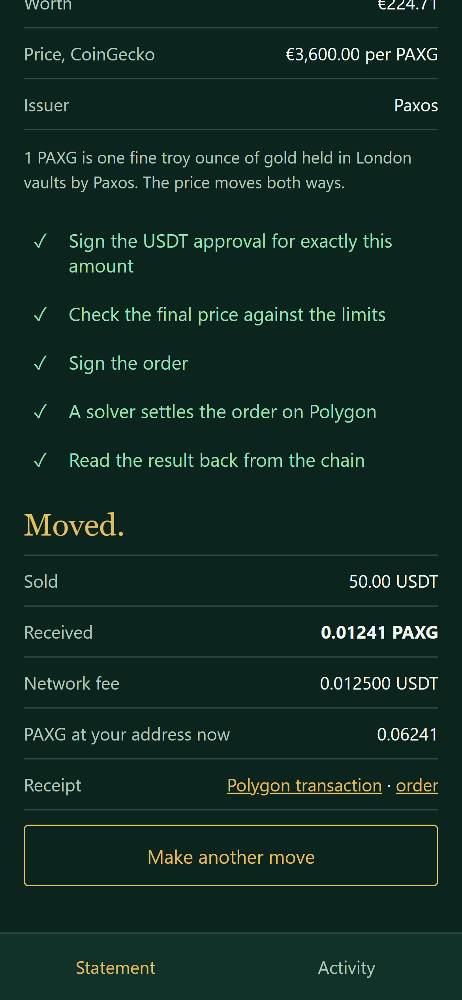
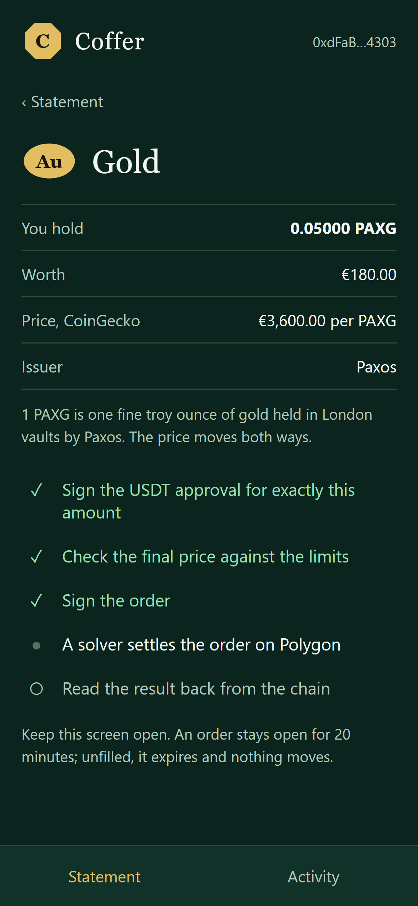
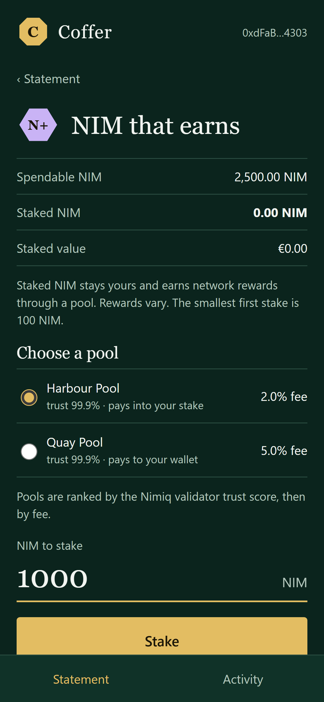
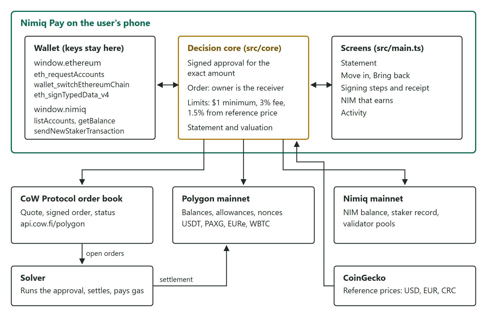

# Coffer: hold gold, euros and bitcoin in Nimiq Pay

[](https://github.com/Marc-Dvci/Coffer/actions/workflows/ci.yml)
[](https://github.com/Marc-Dvci/Coffer/actions/workflows/live.yml)
[](LICENSE)
[](#tests)
[](#tests)

<p align="center">
  
  
  
</p>

**Coffer is a Nimiq Pay Mini App that turns the USDT in the wallet into gold, euros or bitcoin held
at the user's own address, with two signatures and no POL.**

I worked as an IT auditor on payment systems in a bank. Coffer is built the way I would want to
review a savings tool: every limit is code, and every receipt is read back from the chain.

| | |
|---|---|
| Open in Nimiq Pay | https://nimpay.app/miniapps/open/marc-dvci.github.io/Coffer/ |
| Live page | https://marc-dvci.github.io/Coffer/ (prices and quotes are live in any browser) |
| Category | Save, Nimiq Pay Mini Apps Competition, Cycle III |
| Built with | Nimiq Mini App SDK, both wallet providers, CoW Protocol on Polygon, viem, TypeScript, Vite |
| Measured | Nimiq Pay 2.23.0 signed all four token approvals and an order; each one verified on Polygon mainnet ([record](docs/nimiq-pay-check.md)) |

[What it does](#what-it-does) · [For judges](#for-judges) · [How it works](#how-it-works) · [Nimiq Pay integration](#how-nimiq-pay-is-used) · [Limits in code](#limits-in-code) · [Tests](#tests) · [Run it](#run-it)

## What it does

Nimiq's brief for the Save category: "Extend what a user can hold: a different currency, tokenized
gold, bitcoin, or yield-bearing dollars." Coffer does that for someone paid in USDT or NIM who
wants part of it out of dollars: rent due in euros, a first gram of gold, some bitcoin.

1. **Statement.** Everything the wallet holds on one screen, valued in the phone's own currency:
   gold, euros, bitcoin, USDT, NIM and staked NIM.
2. **Move in.** Pick a holding and an amount of USDT. The screen shows the amount received, the
   minimum the order accepts, the network fee and the gap to the market price, before any
   signature.
3. **Sign.** Two "Sign Message" sheets in Nimiq Pay: an approval for exactly that amount, then
   the order. A CoW Protocol solver settles it on Polygon and pays the gas, taking its cost from
   the USDT sold. The wallet needs no POL.
4. **Receipt.** The executed amounts, the Polygon transaction and the new balance, read back from
   the order book and from the chain.
5. **Bring back.** The same flow in reverse, from any holding to USDT.
6. **NIM that earns.** Stake NIM with a validator pool from the same statement. Pools are ranked
   by the Nimiq validator score, then by fee.

| Holding | Token on Polygon | Issuer | One unit |
|---|---|---|---|
| Gold | PAXG | Paxos | One fine troy ounce held in London vaults |
| Euros | EURe | Monerium | One euro of e-money |
| Bitcoin | WBTC | BitGo | One bitcoin in custody |
| NIM that earns | Staked NIM | Nimiq validator pools | NIM that earns network rewards |

Coffer has no server, no contract of its own and no account. Tokens leave the wallet only inside
a settlement the user signed, and arrive at the same address.

<p align="center">
  
  
</p>

Screens are captured by `npm run shots`, which drives the built app with the browser tests' signing
wallet.

## For judges

| Criterion | Where it is answered |
|---|---|
| Functionality, reliability, usefulness (45) | One flow from quote to receipt: [`runMove`](src/core/move.ts#L103). Every way a move can stop has its own outcome and message ("Nothing moved"), covered by [browser tests](tests/e2e/coffer.spec.ts). An empty wallet still sees live prices and is told what to top up |
| Nimiq Pay and Nimiq integration (25) | Both providers do the work: [`src/wallet/evm.ts`](src/wallet/evm.ts) (account, network, typed-data signing) and [`src/wallet/nimiq.ts`](src/wallet/nimiq.ts) (accounts, NIM balance over wallet and HTLC address, staking). NIM is a holding on the statement and can be staked. The phone's currency comes from `getHostFiat` |
| Real usage (15) | A move starts at $1 and a first stake at 100 NIM. Each move is a public order tagged `Coffer` in the CoW order book, listed under Activity |
| Design and UX (10) | Assay-office hallmarks, one per holding, on a dark green ground. Each screen passes an axe-core WCAG 2.2 AA scan in the browser tests |
| Works on the first try | Opening the app asks only for the two connection sheets. The network switch is requested at the first move. Record of the run inside Nimiq Pay: [docs/nimiq-pay-check.md](docs/nimiq-pay-check.md) |

## How it works

<p align="center"></p>

A move is one CoW Protocol order with a pre-settlement call:

1. The app reads the balance, allowance and nonce from Polygon through public RPC endpoints.
2. The wallet signs an approval for the exact amount with `eth_signTypedData_v4`. USDT and EURe
   take an EIP-2612 `permit`. PAXG and WBTC take a Polygon bridge meta-transaction that wraps
   `approve`. [`src/core/approval.ts`](src/core/approval.ts) builds both.
3. The signed approval becomes a hook inside the order document. The order book quotes the move
   with that hook, and [`checkMove`](src/core/guard.ts#L62) applies the limits to the quote.
4. The wallet signs the order: sell the amount typed, receive at least the quote less 0.5%, the
   owner as the only receiver, valid for 20 minutes ([`src/core/order.ts`](src/core/order.ts#L71)).
5. A solver submits one transaction that runs the approval and settles the order. Its gas cost
   is the network fee shown on the quote, paid in the token sold.
6. The app polls the order, then reads the buy-token balance from Polygon for the receipt.

Decisions are deterministic code in `src/core`: amounts, limits, valuation and ranking. The order
book, the chain and the price source supply inputs, and the wallet supplies signatures.

## How Nimiq Pay is used

| Nimiq Pay capability | Call | Why |
|---|---|---|
| Ethereum provider | `eth_requestAccounts` | The Polygon address that holds the user's USDT |
| | `wallet_switchEthereumChain` | Nimiq Pay starts on Ethereum; chain-bound signatures need Polygon |
| | `eth_signTypedData_v4` | Approvals and orders are signed messages, so a move costs the user no gas |
| Nimiq provider | `listAccounts`, `getBalance` | NIM on the statement, summed over the wallet and its HTLC address |
| | `sendNewStakerTransaction`, `sendStakeTransaction` | Stake NIM with the chosen pool, or add to an existing stake |
| Host context | `getHostFiat` | The statement is valued in USD, EUR or CRC to match the phone |
| Nimiq network | `getStakerByAddress`, validators API | The staked balance and the ranked pool list |

## Limits in code

[`LIMITS`](src/core/guard.ts#L4) are checked on the preview and again on the final quote, before the
order signature.

| Rule | Value | Message |
|---|---|---|
| Smallest move | $1 | "The smallest move is $1." |
| Network fee | At most 3% of the amount | "The network fee would take 3.4% of this amount. Move a larger amount." |
| Gap to the CoinGecko price | At most 1.5% below | "This quote is 4.0% below the market price. Move a smaller amount." |
| Reference price | Required | "The market price is unavailable, so this quote cannot be checked." |
| Balance | Amount within the balance | "This is more than the wallet holds." |
| Approval | Exactly the amount moved, valid for one hour | |
| Order | Fill or expire in 20 minutes, 0.5% slippage, owner is the receiver | |

The reference-price rule is what caps a move into a thin pool: a quote that slips more than 1.5%
is refused, and the screen asks for a smaller amount. Coffer shows prices with their source and
promises no return; the note under each holding says the price moves both ways.

## Tests

| Suite | Count | Command | What it covers |
|---|---|---|---|
| Unit | 272 | `npm test` | The decision core, in random order, with a fake clock and real signatures |
| Browser | 17 | `npm run e2e` | Every screen in Chromium at phone size, with a wallet that behaves like Nimiq Pay, and an axe-core scan |
| Live | 9 | `npm run live` | Polygon mainnet, the CoW order book and the validators API |

Decision core coverage (`npm run coverage`), with a CI floor of 90% lines and 80% branches:

| Module | Lines | Branches |
|---|---|---|
| approval.ts | 100% | 92.3% |
| cow.ts | 100% | 92.3% |
| format.ts | 100% | 100% |
| guard.ts | 100% | 92.6% |
| move.ts | 100% | 97.7% |
| order.ts | 100% | 100% |
| prices.ts | 100% | 100% |
| staking.ts | 100% | 100% |
| statement.ts | 100% | 100% |
| tokens.ts | 100% | 100% |
| **Total** | **100%** | **97.2%** |

| Claim | Code | Test |
|---|---|---|
| The approval covers exactly the amount moved | [`approval.ts`](src/core/approval.ts#L69) | `signs an approval for exactly the amount moved, to the CoW vault relayer` |
| Each token's signing domain matches its contract on Polygon | [`tokens.ts`](src/core/tokens.ts#L138) | `hashes the $symbol domain to the separator its contract reports on Polygon` |
| Anyone can submit the signed approval, so the user pays no gas | [`approval.ts`](src/core/approval.ts#L102) | Live: `$symbol accepts the signed approval when anyone submits it` |
| The owner is the only receiver | [`order.ts`](src/core/order.ts#L71) | `submits an order signed by the owner, who is its only receiver` |
| A quote outside the limits is refused before the order signature | [`guard.ts`](src/core/guard.ts#L62) | `refuses a quote that breaks a limit, before the order signature` |
| A declined signature moves nothing | [`move.ts`](src/core/move.ts#L103) | `declining the signature in the wallet moves nothing` |
| An unfilled order expires and says so | [`move.ts`](src/core/move.ts#L103) | `an order no solver fills expires and says nothing moved` |
| Opening the app asks for no network switch | [`evm.ts`](src/wallet/evm.ts#L43) | `opening the app asks only to share the addresses, with no network switch` |
| The receipt balance is read from the chain | [`move.ts`](src/core/move.ts#L103) | `reports what the order book executed and the balance read after settlement` |
| Pools are ranked by score, then fee | [`staking.ts`](src/core/staking.ts#L50) | `puts the highest trust score first`, `breaks a score tie with the lower fee` |
| The statement is valued in the phone's currency | [`statement.ts`](src/core/statement.ts#L40) | `the statement values every holding in the phone’s currency` |

## Run it

Node 24.

```
git clone https://github.com/Marc-Dvci/Coffer.git
cd Coffer
npm ci
npm run dev        # http://localhost:5173, live prices and quotes, no keys
npm test           # 272 unit tests
npx playwright install chromium
npm run build && npm run e2e
```

To open a local build in Nimiq Pay, serve it over HTTPS and enter the address under Mini Apps.
The app is static: `npm run build` writes `dist/`, which GitHub Pages serves.

## Layout

```
src/core/     decision core: tokens, approvals, orders, limits, prices, statement, staking
src/wallet/   the two Nimiq Pay providers and the Polygon reader
src/ui/       styles and hallmarks
src/main.ts   screens and events
tests/        unit, e2e (browser), live (mainnet), shots (README screens)
docs/         screens, architecture, the Nimiq Pay wallet check
```

## What is real

Prices, quotes, balances, validator pools and the order book are the live services. The four
token approvals and the order were signed by Nimiq Pay 2.23.0 and verified on Polygon mainnet.

## Licence

MIT. PAXG, EURe, WBTC and USDT are issued by Paxos, Monerium, BitGo and Tether. Coffer is an
interface to public protocols and gives no financial advice.
